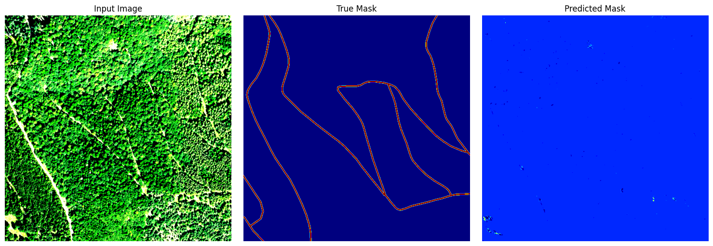
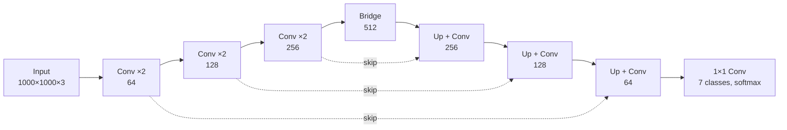
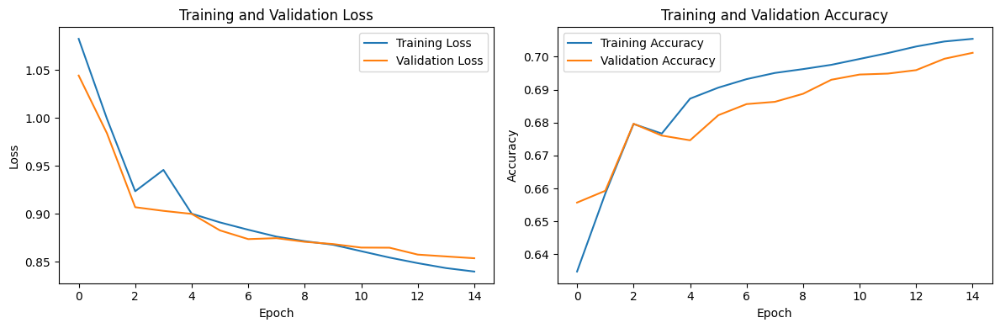

<h1 align="center">Satellite Image Segmentation with U-Net</h1>

  <b>Pixel-by-pixel land-cover segmentation of aerial images from the French IGN archive, with a U-Net built from scratch in TensorFlow.</b> 
  University of Bologna · Deep Learning exam project, A.Y. 2023/24

  
  
  
  

  

## The task

Semantic segmentation gives every pixel of an image a class. Here the images are 1000 × 1000 px aerial photos from the IGN (the French national mapping agency) archive, and the model has to label each pixel with one of **6 land-cover classes plus a "no information" class**.

| | |
|---|---|
| Training set | 600 images with masks |
| Validation set | 200 images with masks |
| Classes | 7 (6 + no information) |
| Evaluation metric | Mean Dice coefficient over all classes |

## The model

A U-Net written layer by layer in Keras:

- **Encoder**: three blocks of two 3 × 3 convolutions + max-pooling (64, 128, 256 filters), then a 512-filter bridge.
- **Decoder**: 2 × upsampling, concatenation with the matching encoder block (skip connection) and two 3 × 3 convolutions, three times, so fine detail survives the downsampling. A 1 × 1 convolution with softmax gives the 7 class probabilities per pixel.
- **Pre-processing**: images standardised per image (zero mean, unit variance), masks one-hot encoded to 7 channels.
- **Training**: Adam, categorical cross-entropy, batch size 2 (full-resolution images), 15 epochs on a Colab GPU. 7,783,303 trainable parameters.

## Results

| Metric | Validation |
|---|---|
| Pixel accuracy | **70.1 %** |
| Mean Dice (7 classes) | **0.21** |

  

Training and validation curves stay close together, so the model is not overfitting, and both were still improving at epoch 15.

**Reading the numbers honestly.** Pixel accuracy is flattered by the dominant class: in forest-heavy tiles the model learns to predict mostly that class, so thin structures such as roads and paths are missed (see the example above). The mean Dice of 0.21 shows this, because it weighs every class equally, including the small ones.

## What I would do next

- **Class-imbalance-aware loss**: Dice or focal loss, or class weights, so rare classes count.
- **Pretrained encoder** (for example ResNet or EfficientNet from ImageNet) instead of training from scratch on 600 images.
- **Data augmentation**: flips, 90° rotations and colour jitter are all valid for aerial images.
- **Tiling**: train on 256 × 256 crops for larger batches and more steps, then stitch predictions.
- **Longer training** with a learning-rate schedule, since the curves had not flattened.

## Run it

Open the notebook in Colab with the badge above. The first cell downloads and unzips the dataset (`ign_dataset.zip`) with `gdown`; a GPU runtime is needed.

## What's in this repo

| File | What it is |
|---|---|
| [`satellite_segmentation_unet.ipynb`](satellite_segmentation_unet.ipynb) | The full notebook with its saved outputs: data loading, model, training log, evaluation and plots |
| [`docs/`](docs) | Figures from the notebook used on this page |

## Skills shown

Semantic segmentation · U-Net architecture · TensorFlow / Keras · `tf.data` pipelines · evaluation with the Dice coefficient

---

Om Mishra · MSc Electronic Engineering, University of Bologna. Dataset: IGN aerial imagery and annotations provided for the course.
